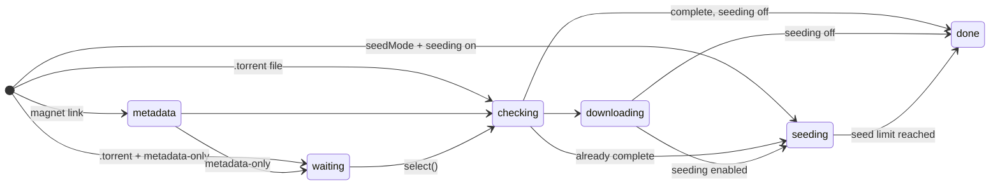

<div align="center">
  
  <h4>A really fast BitTorrent engine written in pure TypeScript.</h4>
</div>

<div align="center">
  
  
  
  
</div>

Tiny Torrent downloads and seeds with no runtime dependencies, in under 5,000 lines of code.

- **Fast and light.** About **3× faster than WebTorrent** on a real swarm, and it keeps pace with qBittorrent's C++ engine at a fraction of its memory.
- **Download only what you want.** Read a torrent's file list before a single block is requested, then pick the files you want. Files you skip are never created on disk.
- **A good seed.** Every downloader gets data within about a second, and upload slots take turns so the swarm is served fairly.
- **Built for servers.** Seed limits that survive restarts, per-torrent and engine-wide speed limits, and every socket bindable to a VPN.

---

**Contents**

- [Install](#install) · [Quick start](#quick-start)
- [Recipes](#recipes): [choose files](#choose-files-before-downloading) · [resume](#survive-restarts-without-re-hashing) · [seed](#seed) · [limit bandwidth](#limit-bandwidth) · [bind to a VPN](#bind-to-a-vpn-address)
- [API reference](#api-reference)
- [How fast is it?](#how-fast-is-it) · [Why Tiny Torrent](#why-tiny-torrent) · [How it works](#how-it-works)
- [What's supported](#whats-supported) · [Troubleshooting](#troubleshooting) · [Development](#development)

---

## Install

Tiny Torrent targets [Bun](https://bun.sh) 1.1 or newer and is published as TypeScript source.

```sh
bun add tinytorrent
```

> [!IMPORTANT]
> Node.js hasn't been tested. The engine uses no Bun-specific APIs, so it should work on Node, but it has not been trialed at all. Realistically though if you're not on Bun... why?

## Quick start

```ts
import { Engine } from "tinytorrent";

const engine = new Engine();
const torrent = engine.add("magnet:?xt=urn:btih:<info hash>", { dir: "/downloads" });

torrent.on("piece", () => {
  console.log(`${(torrent.progress * 100).toFixed(1)}%  ${(torrent.downloadRate / 1e6).toFixed(1)} MB/s`);
});

torrent.on("done", async () => {
  console.log(`${torrent.name} finished`);
  await engine.destroy();
});
```

`engine.add` accepts a magnet link, the bytes of a `.torrent` file, or a torrent you parsed yourself. To add a `.torrent` file from disk:

```ts
const torrentBytes = new Uint8Array(await Bun.file("/path/to/file.torrent").arrayBuffer());
const torrent = engine.add(torrentBytes, { dir: "/downloads" });
```

Files are written under `dir`. A torrent with several files gets its own folder, `dir/<name>/`.

The recipes below assume `engine` from here, and use `magnet` for a magnet link and `torrentBytes` for `.torrent` bytes.

## Recipes

### Choose files before downloading

Add the torrent with `start: "metadata-only"`. Nothing is requested from peers until you call `select()`.

```ts
const torrent = engine.add(magnet, { dir: "/downloads", start: "metadata-only" });

torrent.on("metadata", async () => {
  const files = torrent.files();               // [{ index, path, length, selected, downloaded }]
  const videos = files.filter((f) => f.path.endsWith(".mkv")).map((f) => f.index);
  if (videos.length === 0) return torrent.close({ deleteFiles: true });
  await torrent.select(videos);                // downloading starts here
});
```

Files you don't select are never created on disk.

### Survive restarts without re-hashing

```ts
const engine = new Engine({ resumeDir: "/data/resume" });
```

The engine saves which pieces are verified, the file sizes and modification times, upload and download totals, and time seeded. It saves on pause, close and completion, and every 5 minutes.

On the next `add`, if every selected file's size and modification time still match, nothing is re-hashed. Without `resumeDir`, existing files are re-checked by hash: the work is kept, but it costs CPU.

### Seed

Two options sound alike but do different things:

- **`seed`** keeps uploading after a download finishes, until a limit is reached.
- **`seedMode`** skips the initial hash check because you already have the complete files ([below](#seed-files-you-already-have)).

```ts
const engine = new Engine({
  port: 51413,
  portMapping: true,                                   // ask the router to forward the port (UPnP / NAT-PMP)
  seed: { enabled: true, ratio: 2, minutes: 7 * 24 * 60 },  // stop at ratio 2 or after a week
  resumeDir: "/data/resume",
});

const torrent = engine.add(torrentBytes, { dir: "/data/torrents" });
torrent.on("seeded", () => torrent.close());           // a seed limit was reached
```

With `seed.enabled`, a torrent keeps serving peers once it completes, until it reaches the ratio or the time limit, whichever comes first. Leave a limit out, or set it to `0`, for no limit. Ratio and seed time are counted across restarts when `resumeDir` is set.

One torrent can override the engine's policy with `engine.add(…, { seed: false })`, `{ seed: true }` or `{ seed: { ratio: 5 } }`.

**Make your port reachable.** Peers on the internet can only connect to you if they can reach your port. Use `portMapping: true`, or forward the port on your router yourself. Behind a VPN, set `port` to the port it forwards, or use `portMapping` if it supports NAT-PMP. `engine.stats().mappings` shows whether port mapping worked.

### Seed files you already have

```ts
import { createTorrentFromPath } from "tinytorrent";

const bytes = await createTorrentFromPath("/data/album", { announce: ["udp://tracker.example:1337/announce"] });
await Bun.write("/data/album.torrent", bytes);

const torrent = engine.add(bytes, { dir: "/data", seedMode: true, seed: true });
```

`seedMode: true` tells the engine the files are complete, so it starts serving at once instead of hashing everything first. Each piece is checked the first time it is uploaded. If one fails, the torrent drops out of seed mode, re-checks everything, and downloads whatever is missing.

> [!NOTE]
> Seed mode only applies when every selected file is already at its full size. Otherwise the engine hashes the existing data as usual.

`createTorrentFromPath` takes a file or a directory and picks a sensible piece size. It can also set trackers, a private flag, a comment and web seeds. Web seeds are written into the torrent for other clients; Tiny Torrent doesn't download from them.

### Limit bandwidth

```ts
const engine = new Engine({
  upload:   { limitBytesPerSecond: 5_000_000 },    // whole engine
  download: { limitBytesPerSecond: 20_000_000 },
});
const torrent = engine.add(magnet, { dir: "/downloads", limits: { uploadBytesPerSecond: 1_000_000 } });   // one torrent

engine.setLimits({ uploadBytesPerSecond: 0 });     // change at runtime; 0 = unlimited
torrent.setLimits({ downloadBytesPerSecond: 500_000 });
```

Engine and torrent limits both apply: a torrent never goes over its own limit, and all torrents together never go over the engine's.

### Bind to a VPN address

By default the engine uses the system's normal network routes, and nothing here is needed. If you want all torrent traffic to use one local address, typically a VPN's, bind it:

```ts
import { Engine, boundTransport } from "tinytorrent";

// `vpn` stands for your own code that watches the VPN connection.
const engine = new Engine({
  transport: boundTransport({ address: () => vpn.localAddress() ?? null }),
  encryption: "prefer-plaintext",   // optional: the VPN already encrypts; cheaper on CPU
  resumeDir: "/data/resume",
});

vpn.on("down", () => engine.disconnect());   // every socket closes; files and progress kept
vpn.on("up",   () => engine.reconnect());    // resumes every torrent
```

> [!NOTE]
> `reconnect()` resumes every torrent, including any you had paused yourself before `disconnect()`. Pause those again afterwards if they should stay paused.

Every peer connection, tracker request (UDP and HTTP), DHT packet and port-mapping request is bound to the address the function returns. The function is called again for each new socket.

When it returns `null`, nothing connects at all: the engine *fails closed*.

> [!WARNING]
> Binding sets each socket's source address; it doesn't pin a network device. Which interface packets leave through is still up to your routing table, so make sure traffic from the VPN's address is routed through the tunnel.

### Other things you can do

- **Pause and resume:** `await torrent.pause()` and `torrent.resume()`. Files and progress are kept. Add a torrent paused with `{ paused: true }`.
- **Re-check the files:** `await torrent.recheck()` hashes the files on disk again, after you moved, replaced or suspect them, then downloads whatever is missing.
- **Move a torrent's files:** `close()` the torrent, rename its directory, then `add()` it again with the new `dir`. A rename keeps modification times, so the resume state still matches and nothing is re-hashed.
- **Never upload (leech only):** `upload: { slots: 0 }` uploads to no one.
- **Block peers:** pass `allowPeer: (ip) => !blocklist.has(ip)` to the engine.
- **Restart the DHT warm:** save `engine.dhtNodes()` (and `dhtNodes6()`) and pass them back as `dht: { nodes, nodes6 }`. Without them, a magnet with no trackers has to wait for DHT bootstrap.

## API reference

The recipes above cover everyday use. For every option, default, method, event and `stats()` field, see the [API reference](docs/API.md).

## How fast is it?

Every Tiny Torrent number below comes from the same pure TypeScript engine: no native addons and no dependencies, just JavaScript running on Bun. It is compared against three widely used engines.

### Downloading

An Orange Pi 5 Plus (8-core ARM) downloaded from the Debian DVD's public swarm over a home connection through a VPN. Each engine ran for 90 s, back to back, in two rounds; these are the averages:

| Engine | Language | Speed | CPU per GB | Memory |
|---|---|---|---|---|
| **Tiny Torrent** | TypeScript | **113 Mbit/s** | 20 s | 280 MB |
| qBittorrent (libtorrent) | C++ | 107 Mbit/s | 30 s | 1.2 GB |
| aria2 | C++ | 88 Mbit/s | 14 s | 35 MB |
| WebTorrent | JavaScript | 36 Mbit/s | 226 s | 300 MB |

- **Level with qBittorrent**, with a third less CPU and under a quarter of the memory.
- **3× faster than WebTorrent** at about 12× less CPU per byte. WebTorrent is limited by its CPU and keeps a whole core busy.
- About **30% faster than aria2**.

> [!NOTE]
> qBittorrent also used the torrent's HTTP web seed, which contributed about 9 Mbit/s of its speed. Tiny Torrent doesn't use web seeds.

### Seeding

One engine seeded a 1 GiB file to 8 lean downloaders on the same machine. The downloaders throw the data away, so only the seeder is measured.

**ARM board, the seeder pinned to one core:**

| Engine | Language | Plaintext | CPU per GB | Encrypted (RC4) | Memory |
|---|---|---|---|---|---|
| **Tiny Torrent** | TypeScript | **6.9 Gbit/s** | **1.15 s** | **1.9 Gbit/s** | **150 MB** |
| qBittorrent (libtorrent) | C++ | 8.5 Gbit/s | 0.95 s | 1.75 Gbit/s | 1.1 GB |
| aria2 | C++ | 5.6 Gbit/s | 1.36 s | 2.05 Gbit/s | 65 MB |
| WebTorrent | JavaScript | 1.9 Gbit/s | 4.2 s | 1.2 Gbit/s | 200 MB |

**Whole machine, plaintext:**

| Engine | ARM board (8 cores) | M-series Mac |
|---|---|---|
| **Tiny Torrent** | **10.3 Gbit/s** | **52 Gbit/s** |
| qBittorrent (libtorrent) | 11.0 Gbit/s | 45 Gbit/s |
| aria2 | 5.6 Gbit/s | — |
| WebTorrent | 2.4 Gbit/s | 14 Gbit/s |

- **Close to qBittorrent's C++ engine.** Core for core, qBittorrent is about 20% faster in plaintext and Tiny Torrent 8% faster with encryption. On a whole machine Tiny Torrent is within 7% on ARM and 14% ahead on the Mac, in a seventh of the memory.
- **3.6× faster than WebTorrent** per core in plaintext, and 1.6× with encryption.
- **Faster than aria2 in plaintext,** and fair: every downloader gets its first byte within a second, where aria2 serves only some at a time. aria2 is fastest with encryption, using OpenSSL's cipher.
- An idle engine uses about 1% of an ARM core.

The test hardware, every result (including the encrypted runs) and the methods are in [Benchmarks](docs/BENCHMARKS.md).

## Why Tiny Torrent

Tiny Torrent was built for [Findr](https://github.com/Benzo-Fury/Findr), a self-hosted movie and TV downloader that runs on small home servers behind a VPN. Findr started out on [WebTorrent](https://github.com/webtorrent/webtorrent), the obvious choice for a JavaScript project, and it was too slow: on an 8-core ARM board it topped out at 6–10 Mbit/s on a link capable of well over 100.

WebTorrent is designed for browsers and streaming, and Findr also had to work around it to get what a download pipeline needs. Tiny Torrent makes each of those part of the API:

| What Findr needed | Workaround on WebTorrent | Tiny Torrent |
|---|---|---|
| Choose files before any data is requested | Gate block requests itself | Built in (`start: "metadata-only"`) |
| Bind every socket, including trackers, to the VPN | Patch Node's `net` and `dgram` for the whole process, and switch off HTTP trackers | Built in, fails closed |
| Pause everything on a killswitch and carry on | Destroy the whole client and re-verify the files | `disconnect()` / `reconnect()` |
| Run reliably on a small board | Patch dependencies to stop a crash and a Diffie–Hellman setup costing ~200 ms of CPU per peer | Under 5,000 lines, no dependencies |
| Restart without re-hashing | Not built in | Resume state |
| Seeding limits by ratio or time | Not built in | Built in, survive restarts |
| Ban peers that send corrupt data | Not built in | Smart ban, even when a piece came from several peers |
| Browsers, WebRTC, streaming | Supported | Not supported |

So we wrote the engine we wanted: as fast as native clients, small enough to read in an afternoon, and built for servers.

## How it works

**One engine, many torrents.** An `Engine` owns the listening port, the DHT, tracker sockets, rate limits and a single 250 ms timer that drives everything. Each `Torrent` finds peers through trackers, the DHT and peer exchange, then downloads, verifies and saves pieces.

### A torrent's life



| State | What's happening |
|---|---|
| `metadata` | A magnet is fetching the file list from peers |
| `waiting` | The file list is known; waiting for `select()` (only with `start: "metadata-only"`) |
| `checking` | Data already on disk is being verified |
| `downloading` | Fetching pieces |
| `seeding` | Complete and serving peers until a seed limit (only when seeding is enabled) |
| `done` | Finished and disconnected |
| `paused` | After `pause()`, `disconnect()`, `paused: true` or an `error`, from any active state; `resume()` picks up where it left off |
| `closed` | After `close()` |

### Downloading

The engine asks for the rarest pieces first, finishes partly downloaded pieces before starting new ones, and in the last few pieces asks two peers for the same blocks (*endgame*). How many requests it keeps open with each peer depends on that peer's speed and round-trip time.

Every piece is hashed before it's written. If a piece fails its hash, the peer that sent the bad data is banned, even when several peers contributed to the piece (*smart ban*). Data is written straight into full-length sparse files.

### Uploading

While downloading, the engine uploads to the peers that send it the most data (*tit for tat*: you give to those who give to you), plus one peer rotated at random so new peers get a chance.

While seeding there is nothing to trade, so the aim is speed and fairness. More peers get an upload slot as long as each keeps taking data. Free slots are filled within 250 ms, and peers take turns every 20 s so everyone waiting is served. Pieces are read from disk in 512 KiB chunks into a shared cache, so several peers fetching the same piece cost one disk read.

### Being a good citizen

The engine sends trackers correct `started`, `completed` and `stopped` messages and the exact number of bytes left. A seed re-announces to the DHT every 15 minutes, tells peers it only uploads, and disconnects from other seeds.

### Encryption

`encryption` controls BitTorrent's stream obfuscation (MSE/PE):

| Value | Behaviour |
|---|---|
| `prefer` (default) | Encrypt outgoing connections; accept both kinds incoming |
| `prefer-plaintext` | Plaintext first; encrypt only for peers that insist. Cheapest on CPU, e.g. when traffic already goes through a VPN |
| `require` | Encrypted only |
| `off` | Plaintext only |

The [in-depth design notes](docs/HOW-IT-WORKS.md) go further.

## What's supported

| | |
|---|---|
| **Finding peers** | UDP and HTTP trackers, DHT (IPv4 and IPv6), peer exchange (IPv4 and IPv6), magnet links, port mapping (NAT-PMP, UPnP) |
| **Talking to peers** | TCP over IPv4 and IPv6, MSE/PE encryption, the fast extension, extension protocol, metadata exchange, `upload_only` |
| **Torrent formats** | v1 torrents and v1+v2 hybrids (through their v1 half), padding files, private torrents, magnet `so=` file selection |
| **Interoperability** | Conformance suite against libtorrent (the engine in qBittorrent and Deluge) and Transmission, and interop tests with WebTorrent, in both directions. Benchmarked against aria2 |

**Not supported, on purpose:**
- uTP: TCP reaches nearly every peer, and a pure-TypeScript uTP would be large and slow.
- Pure v2 torrents.
- Web seeds.
- Streaming and sequential download.
- Local peer discovery.
- Browsers and WebRTC.
- A torrent queue or an RPC server: those belong in the application that uses the engine.

## Troubleshooting

| Symptom | Likely fix |
|---|---|
| A magnet never finds peers | Without trackers it depends on the DHT: make sure UDP isn't blocked, and save and restore `dhtNodes()` |
| Slow downloads | Check `torrent.stats()`: few `candidates` means discovery is the problem, most peers choking us is the swarm, high `rtt` is the link |
| Nobody downloads from my seed | Your port isn't reachable: use `portMapping` or forward it yourself (behind a VPN, use its forwarded port) |
| Everything is re-hashed on restart | Set `resumeDir`, and keep file modification times when moving files |
| High CPU | Profile first; on encrypted-heavy swarms or through a VPN, `encryption: "prefer-plaintext"` helps |
| The seed stopped by itself | A seed limit was reached; listen for `seeded` and check `torrent.seedLimits()` |

In `torrent.stats()`, `candidates` are addresses found but not yet connected, a peer that is *choking* us is refusing to send data for now, and `rtt` is a peer's round-trip time. [Troubleshooting](docs/TROUBLESHOOTING.md) goes symptom by symptom and explains every field.

## Development

```sh
bun install
bun test                  # the full suite: units, fuzzing, real swarms on loopback, interop with WebTorrent
bunx tsc --noEmit         # type check
bun scripts/lines.ts      # the line budget (under 5,000 lines of code)
bun bench/cli.ts …        # benchmarks: local, real, seeding, real-seed, micro
sh conformance/run.sh     # Docker: against libtorrent and Transmission
```

Read [Development](docs/DEVELOPMENT.md) before changing the engine. It covers the code layout, the tests, the conformance suite and the rules a change has to follow. The rest of [`docs/`](docs/README.md) is in-depth reference for people working on the engine itself.

## License

[Apache License 2.0](LICENSE). See [NOTICE](NOTICE) for attribution.
